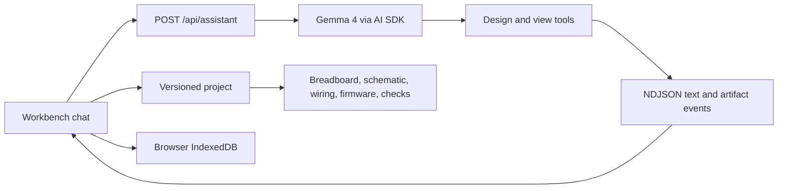

# Architecture

ProtoPilot has one canonical project object. The chat assistant creates or replaces it; the workbench derives its visualizations and checks from that object.

## Source map

| Area | Main files |
| --- | --- |
| Pages and chat UI | `app/page.tsx`, `app/workbench/page.tsx` |
| Assistant route and tool actions | `app/api/assistant/route.ts` |
| Compact AI plan and expansion | `lib/ai/compact-project.ts` |
| Canonical project shape | `lib/project/schema.ts` |
| Wiring table and electrical checks | `lib/project/derive.ts` |
| Diagram renderers | `components/breadboard-view.tsx`, `components/schematic-view.tsx` |
| Local drafts, messages, and image assets | `lib/storage/indexeddb.ts` |

The older `app/api/projects/generate` and `app/api/projects/revise` endpoints remain in the repository. The current workbench chat sends turns to `/api/assistant`; it does not call those older endpoints.

## Request and render flow

The browser sends the new message, recent text history, the current project, and its ID to the assistant route. The server calls Gemma with the available tools and streams newline-delimited JSON events. Text deltas appear in chat as they arrive. A successful design tool call sends a validated project event; the browser then updates the current workbench. A view tool call adds a diagram, schematic, or firmware artifact card to chat. See [Assistant](assistant.md) for the event contract.

The breadboard, schematic, and wiring table read the same `connections` and component pins. Firmware is stored in the project rather than generated by the diagram renderers. The deterministic checks in `lib/project/derive.ts` inspect the project data; they do not simulate a physical circuit.

## Persistence

IndexedDB stores project drafts, chat messages, and image assets in the browser. Assistant artifact messages include a project snapshot so older cards keep the data from that turn. There is no server database or cross-device synchronization.
